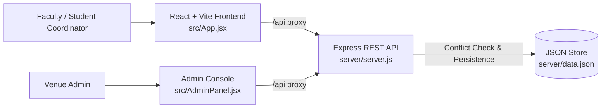

# 🏛️ CampusVenue — Seminar Hall & Auditorium Allocation System


**CampusVenue** is a lightweight, full-stack web application designed for colleges and universities to streamline the booking and allocation of **Seminar Halls, Auditoriums, and Conference Rooms**. It eliminates scheduling clashes through real-time time-slot conflict detection, suggests alternative venues automatically, and provides a dedicated Admin Console for approvals and maintenance control.

---

## ✨ Key Features

- **📅 Real-Time Slot Availability Checker:** Filter campus venues by date, start/end time, and minimum attendee capacity to immediately see which halls are `Available`, `Booked`, or under `Maintenance`.
- **⚡ Smart Conflict Detection & Alternative Suggestions:** The backend prevents double-booking of overlapping time slots and automatically recommends other free halls that fit the requested crowd size.
- **📋 Interactive Schedule & Booking Tracker:** View all campus allocations in chronological order, search by event/organizer/department, filter by status (`Approved`, `Pending`, `Rejected`), and cancel bookings.
- **🔐 Admin Coordinator Console (PIN Protected):** Approve or reject pending requests with custom remarks (with re-validation against conflicts), add new campus halls dynamically, and toggle venue maintenance mode.
- **🪶 Minimal & Clean Architecture:** Built with only **10 core project files** — easy to read, explain, maintain, and deploy.

---

## 🏗️ System Architecture



---

## 👥 Team & Module Ownership

This project is collaboratively built by a **2-member team** with clear separation of modules and dedicated feature branches:

| Team Member | GitHub | Branch | Owned Files | Key Responsibilities |
| :--- | :--- | :--- | :--- | :--- |
| **Arushi Verma** | [@varushi880-bot](https://github.com/varushi880-bot) | `feature/frontend-booking` | `src/App.jsx`, `src/main.jsx`, `src/styles.css` | Venue catalog UI, live availability filter, booking modal, conflict alternative switcher, schedule view & responsive styling |
| **Anshiki Singh** | [@Ifyouknowyouknow2](https://github.com/Ifyouknowyouknow2) | `feature/backend-admin` | `server/server.js`, `server/data.json`, `src/AdminPanel.jsx` | Express REST APIs, time-overlap conflict engine, alternative hall recommender, data persistence & Admin Console |

> **Shared Setup Files:** `package.json`, `vite.config.js`, `index.html`, `README.md`

---

## 📂 Project Structure

```text
seminar-hall-allocator/
├── index.html              # Application entry HTML
├── package.json            # Unified scripts & dependencies
├── vite.config.js          # Vite config with /api proxy to backend
├── README.md               # Project documentation
├── server/
│   ├── server.js           # Express API, conflict engine & admin routes
│   └── data.json           # Pre-seeded venues & bookings storage
└── src/
    ├── main.jsx            # React root bootstrap
    ├── App.jsx             # Main UI: venues, availability filter, booking modal & schedule
    ├── AdminPanel.jsx      # Coordinator console: approvals, add hall & maintenance toggle
    └── styles.css          # Responsive dashboard styling
```

---

## 🔌 REST API Endpoints

| Method | Endpoint | Description |
| :--- | :--- | :--- |
| `GET` | `/api/halls` | Fetch all halls with live availability for `?date&startTime&endTime&attendees` |
| `POST` | `/api/halls` | Add a new seminar hall or auditorium *(Admin)* |
| `PATCH` | `/api/halls/:id/toggle` | Toggle maintenance mode for a venue *(Admin)* |
| `GET` | `/api/bookings` | List bookings with optional `?status` and `?date` filters |
| `POST` | `/api/bookings` | Submit a new booking request (validates capacity & time overlaps) |
| `PATCH` | `/api/bookings/:id/status` | Approve or reject a booking request with optional remark *(Admin)* |
| `DELETE` | `/api/bookings/:id` | Cancel / delete an existing booking |
| `POST` | `/api/admin/verify` | Verify Admin Coordinator PIN |

---

## 🚀 Getting Started (Run Locally)

### Prerequisites
- **Node.js** (v18 or higher) and **npm**

### Installation & Run
```bash
# 1. Clone the repository
git clone https://github.com/varushi880-bot/Seminar-Hall-Auditorium-Allocation-System.git
cd Seminar-Hall-Auditorium-Allocation-System

# 2. Install dependencies
npm install

# 3. Start both Backend API and Frontend Dev Server together
npm run dev
```

### Access URLs & Demo Credentials
- **Web App (Frontend):** `http://localhost:5173`
- **REST API (Backend):** `http://localhost:5000`
- **Admin Console Demo PIN:** `1234`

---

## 🛠️ Tech Stack

- **Frontend:** React 18, Vite 6, Modern CSS3 (Responsive Grid & Flexbox)
- **Backend:** Node.js, Express 4, CORS
- **Storage:** Lightweight JSON file persistence (`server/data.json`)
- **Dev Tooling:** Concurrently (single-command full-stack dev runner), Git feature-branch workflow

---

## 🔮 Future Enhancements
- Role-based authentication (JWT / College Google OAuth)
- Automated email notifications on booking approval/rejection
- Exportable monthly allocation reports (PDF / CSV)
- Migration to MongoDB or PostgreSQL for multi-campus scale
